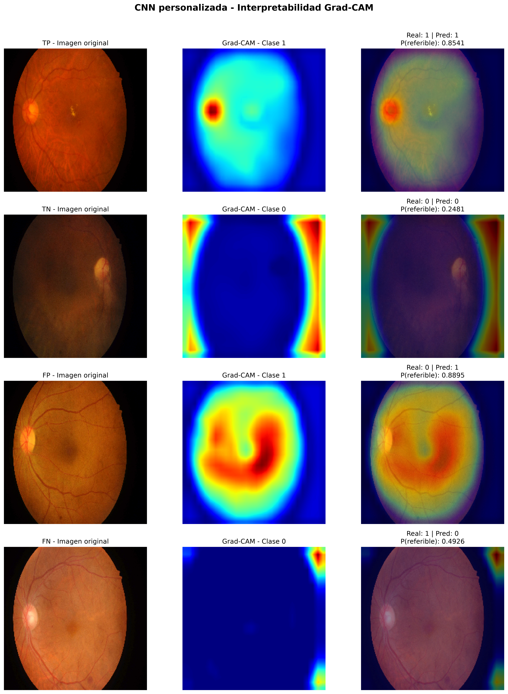

# Detección Asistida de Retinopatía Diabética mediante Deep Learning

[](https://www.python.org/)
[](https://www.tensorflow.org/)
[](https://idrid.grand-challenge.org/)
[]()

Repositorio de investigación enfocado en el desarrollo, optimización clínica y explicabilidad de modelos de aprendizaje profundo para el cribado (*screening*) automatizado de **Retinopatía Diabética Referible (RDR)** a partir de retinografías digitales del dataset **IDRiD** (*Indian Diabetic Retinopathy Image Dataset*).

---

## 📊 Benchmark Consolidado de Modelos

Todos los modelos fueron evaluados sobre el conjunto de evaluación estandarizado del dataset IDRiD ($N = 83$ casos de prueba: 52 patológicos, 31 sanos).

| Modelo | Umbral ($\tau$) | Sensibilidad | Especificidad | Accuracy | F1-Score | AUC-ROC | PR-AUC | Propósito / Enfoque Clínico |
| :--- | :---: | :---: | :---: | :---: | :---: | :---: | :---: | :--- |
| **ConvNeXt-Tiny (Clinical)** | $0.379$ | **1.0000** | 0.6774 | 0.8795 | 0.9123 | 0.9870 | **0.9929** | **Triaje Clínico:** Cero falsos negativos ($FN=0$). Máxima seguridad de cribado. |
| **ResNet50 (Fine-Tuning Opt)** | $0.632$ | 0.9423 | **0.9355** | **0.9398** | **0.9515** | **0.9876** | 0.9931 | **Diagnóstico Equilibrado:** Mejor F1-Score global y balance general clínico. |
| **ResNet50 (Baseline 0.5)** | $0.500$ | 0.9615 | 0.8710 | 0.9277 | 0.9434 | 0.9876 | 0.9931 | Punto de corte por defecto sin calibración de costo. |
| **CapsuleNet** | $0.500$ | 0.8846 | 0.7742 | 0.8434 | 0.8762 | — | — | Preservación de relaciones espaciales entre lesiones retinarias. |
| **CNN Personalizada** | $0.500$ | 0.8077 | 0.8387 | 0.8193 | 0.8485 | 0.8958 | 0.9336 | Baseline convolucional auditado con interpretabilidad Grad-CAM. |
| **EfficientNetB0 + CBAM** | $0.500$ | 0.4231 | 0.1613 | 0.3253 | 0.4400 | 0.1948 | — | Experimento de atención convolucional (análisis de colapso de gradiente). |

> 📌 Para la discusión metodológica detallada, causas de fallos en atención y trade-offs médicos, consulta [docs/discussion.md](docs/discussion.md).

---

## 🔍 Explicabilidad y Validación Médica (Grad-CAM)

En aplicaciones de salud no basta con alta precisión; el modelo debe fundamentar sus predicciones en anomalías biológicas reales. Se implementó una auditoría visual mediante mapas **Grad-CAM** (*Gradient-weighted Class Activation Mapping*):



* **Verdaderos Positivos (TP):** Foco prioritario sobre microaneurismas periféricos, exudados algodonosos y exudados duros perimaculares.
* **Verdaderos Negativos (TN):** Distribución uniforme de atención sobre el parénquima retiniano sin activación focal anómala.
* **Auditoría de Errores (FP / FN):** Detección de posibles sesgos provocados por iluminación periférica y artefactos del lente oftalmológico.

---

## 📁 Estructura del Repositorio

La arquitectura del proyecto sigue el estándar de reproducibilidad científica:

```text
PROYECTO_FINAL/
│
├── docs/                                # Documentación académica y discusión
│   └── discussion.md                    # Análisis clínico, trade-offs y limitaciones
│
├── results/                             # Salidas reproducibles y consolidadas
│   ├── figures/                         # Mapas Grad-CAM, curvas ROC y análisis de error
│   ├── benchmark_summary.json           # Métricas cuantitativas de todos los modelos
│   └── benchmark_summary.md             # Tabla comparativa en formato Markdown
│
├── scripts/                             # Automatizaciones y pipelines
│   └── consolidate_metrics.py           # Script consolidaddor de métricas clínicas
│
├── notebooks/                           # Entornos de experimentación y entrenamiento
│   ├── CNN.ipynb                        # CNN personalizada con Grad-CAM
│   ├── ConvNeXt_Tiny_Clinical.ipynb     # Calibración clínica y optimización de umbral
│   ├── ResNet50.ipynb                   # Transfer learning en 2 fases
│   ├── CapsuleNet.ipynb                 # Redes de cápsulas
│   └── EfficientNetB0.ipynb             # Modelos con y sin atención CBAM
│
├── .gitignore                           # Exclusión de datos pesados (data/) y pesos (*.keras)
├── pyproject.toml                       # Especificación de dependencias (uv / pip)
└── README.md                            # Documento ejecutivo principal
```

---

## 🚀 Instalación y Reproducción

### 1. Clonar el repositorio
```bash
git clone https://github.com/laurita21rios-sudo/PROYECTO_FINAL_.git
cd PROYECTO_FINAL_
```

### 2. Configurar el entorno de Python
Puedes utilizar [`uv`](https://github.com/astral-sh/uv) o `pip`:

```bash
# Con uv (recomendado, ultrarrápido):
uv sync

# O con pip estándar:
python -m venv .venv
source .venv/bin/activate  # En Windows: .venv\Scripts\activate
pip install -r requirements.txt
```

### 3. Descarga Automática del Dataset desde Kaggle
El dataset base de entrenamiento y evaluación es [`mohamedabdalkader/indian-diabetic-retinopathy-image-dataset-idrid2`](https://www.kaggle.com/datasets/mohamedabdalkader/indian-diabetic-retinopathy-image-dataset-idrid2). Puedes descargarlo directamente mediante el CLI de Kaggle:

```bash
kaggle datasets download -d mohamedabdalkader/indian-diabetic-retinopathy-image-dataset-idrid2 -p data/IDRiD2 --unzip
```

### 4. Soporte Multi-Entorno (Local / Kaggle / Colab)
El proyecto incluye un detector automático de entorno en [`src/env_setup.py`](src/env_setup.py). Tanto los notebooks como los scripts adaptan sus rutas de trabajo y tamaño de lote (`BATCH_SIZE`) según la plataforma:

```python
from src.env_setup import get_env_paths

cfg = get_env_paths()
print(f"Entorno activo: {cfg['env']}")          # 'local', 'kaggle' o 'colab'
print(f"Ruta de datos: {cfg['data_dir']}")       # Resuelve automáticamente
print(f"Batch size: {cfg['batch_size']}")        # 32 en GPU nube, 16 en local
```

### 5. Ejecutar la consolidación de métricas
Para recalcular y actualizar automáticamente la tabla de resultados a partir de los registros de inferencia:

```bash
python scripts/consolidate_metrics.py
```

---

## 📑 Principales Conclusiones Clínicas

1. **Estrategia Óptima de Despliegue en Salud:**
   * **Fase 1 (Cribado masivo no invasivo):** Desplegar `ConvNeXt-Tiny` con umbral ajustado a $0.379$. Garantiza que ningún paciente enfermo quede sin atención ($FN=0$).
   * **Fase 2 (Confirmación diagnóstica / Triaje especializado):** Desplegar `ResNet50` con umbral $0.632$ para maximizar precisión y especificidad ($93.55\%$), reduciendo remisiones innecesarias.
2. **Importancia de la Explicabilidad:** La validación con mapas Grad-CAM confirmó que la red aprende características anatómicas genuinas y no atajos estadísticos del fondo del ojo.

Para más detalles, consulta el documento completo de discusión en [docs/discussion.md](docs/discussion.md).
