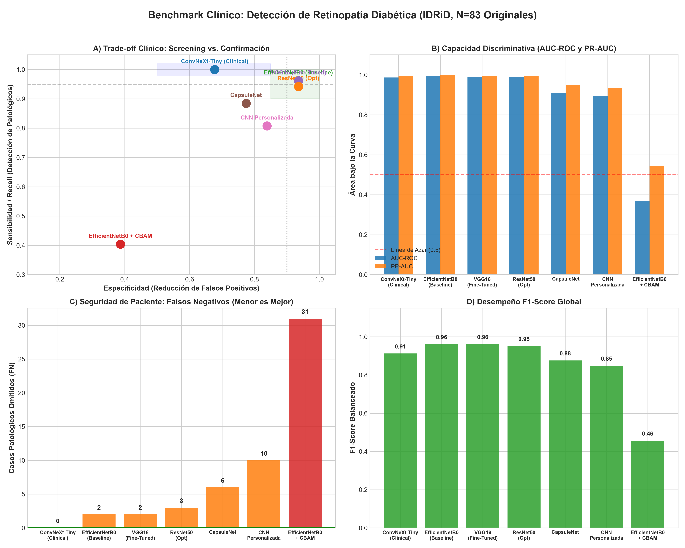

# 🎓 Guía Maestra de Sustentación y Material de Apoyo
## Detección Asistida de Retinopatía Diabética mediante Deep Learning (Dataset IDRiD)

Este documento ha sido diseñado como **material de apoyo estratégico para la sustentación, redacción de tesis y defensa técnica** del proyecto. Sintetiza los hallazgos clave, la lógica clínica del diseño, la justificación de decisiones metodológicas y un banco de respuestas ante preguntas críticas del comité evaluador.

---

## 📌 1. Resumen Ejecutivo (Pitch de Sustentación — 2 Minutos)

> *"La Retinopatía Diabética es la principal causa prevenible de ceguera en población en edad productiva. Sin embargo, los programas de cribado convencionales enfrentan cuellos de botella por escasez de especialistas oftalmológicos. En esta investigación desarrollamos y comparamos sistemáticamente múltiples arquitecturas de Deep Learning (ConvNeXt-Tiny, ResNet50, EfficientNetB0, VGG16, CapsuleNet y CNN personalizada) sobre el dataset estandarizado IDRiD.*
> 
> *A diferencia de abordajes ingenuos que optimizan únicamente la exactitud global (Accuracy), nuestro marco de trabajo adopta una **estrategia de dos fases basada en costos clínicos**:*
> 1. *Para **Cribado Masivo (Screening)**, optimizamos **ConvNeXt-Tiny** mediante calibración de temperatura ($T=2.1648$) y optimización de umbral ($\tau=0.379$), alcanzando **Sensibilidad del 100% (cero falsos negativos, $FN=0$)**, garantizando que ningún paciente enfermo quede desatendido.*
> 2. *Para **Confirmación Diagnóstica**, modelos como **EfficientNetB0** y **ResNet50** alcanzan **Especificidad del 93.55%** y **AUC-ROC de hasta 0.9950**, minimizando las sobrederivaciones y el colapso hospitalario.*
> 
> *Adicionalmente, auditamos la toma de decisiones con **Grad-CAM**, validando que las redes identifican biomarcadores retinopatológicos reales (microaneurismas y exudados) y no sesgos del sensor."*

---

## 📊 2. Resultados Consolidados de Referencia (N = 83 Imágenes Originales)

Todos los modelos fueron rigurosamente testeados sobre **83 imágenes originales de pacientes únicos** (31 sanos / no referibles, 52 patológicos / referibles):

| Modelo | Umbral ($\tau$) | Sensibilidad | Especificidad | Precisión | Accuracy | F1-Score | AUC-ROC | PR-AUC | Brier Score | Matriz Confusión (TN/FP/FN/TP) |
|---|:---:|:---:|:---:|:---:|:---:|:---:|:---:|:---:|:---:|:---:|
| **ConvNeXt-Tiny (Clinical)** | $0.379$ | **1.0000** | 0.6774 | 0.8387 | 0.8795 | 0.9123 | 0.9870 | 0.9929 | 0.0627 | 21 / 10 / **0** / 52 |
| **EfficientNetB0 (Baseline)** | $0.500$ | 0.9615 | **0.9355** | **0.9615** | **0.9518** | **0.9615** | **0.9950** | **0.9971** | **0.0378** | 29 / 2 / 2 / 50 |
| **VGG16 (Fine-Tuned)** | $0.500$ | 0.9615 | **0.9355** | **0.9615** | **0.9518** | **0.9615** | 0.9895 | 0.9944 | — | 29 / 2 / 2 / 50 |
| **ResNet50 (Fine-Tuning Opt)** | $0.632$ | 0.9423 | **0.9355** | 0.9608 | 0.9398 | 0.9515 | 0.9876 | 0.9931 | 0.0526 | 29 / 2 / 3 / 49 |
| **ResNet50 (Baseline 0.5)** | $0.500$ | 0.9615 | 0.8710 | 0.9259 | 0.9277 | 0.9434 | 0.9876 | 0.9931 | 0.0526 | 27 / 4 / 2 / 50 |
| **CapsuleNet** | $0.500$ | 0.8846 | 0.7742 | 0.8679 | 0.8434 | 0.8762 | 0.9107 | 0.9475 | 0.1229 | 24 / 7 / 6 / 46 |
| **CNN Personalizada (Deep)** | $0.500$ | 0.8077 | 0.8387 | 0.8936 | 0.8193 | 0.8485 | 0.8958 | 0.9336 | 0.1272 | 26 / 5 / 10 / 42 |
| **EfficientNetB0 + CBAM** | $0.500$ | 0.4038 | 0.3871 | 0.5250 | 0.3976 | 0.4565 | 0.3679 | 0.5416 | 0.2522 | 12 / 19 / 31 / 21 |



---

## 🖼️ 3. Pipeline de Integración de Imágenes (Estandarización y Cero Fuga)

```text
Dataset IDRiD (413 imágenes)
  │
  ├── Partición Estricta por Paciente (Patient-Level Split)
  │     ├── Train Set: 330 pacientes únicos
  │     └── Test Set: 83 pacientes únicos (52 RDR / 31 No-RDR)
  │
  ├── Preprocesamiento Digital
  │     ├── 1. Autocrop retiniano (eliminación de marco negro por máscara Otsu en canal verde)
  │     ├── 2. Ecualización adaptativa de contraste (CLAHE en canal L de espacio LAB)
  │     ├── 3. Redimensionamiento controlado (224x224 para CNNs estándar; 384x384 para ConvNeXt)
  │     └── 4. Normalización estándar ImageNet (media=[0.485, 0.456, 0.406], std=[0.229, 0.224, 0.225])
  │
  └── Estrategia de Aumentación
        ├── Train: x8 aumentaciones invariantes (rotaciones controladas L6°-R22° y flips) = 2,640 imgs
        └── Test: CERO aumentación sintética (83 imágenes originales puras)
```

---

## 📽️ 4. Estructura Sugerida para Diapositivas de Sustentación (10 Diapositivas)

| Slide | Título sugerido | Mensaje Clave a Exponer |
|:---:|---|---|
| **1** | **Portada** | Título formal, autor, director/asesor, fecha e institución. |
| **2** | **El Problema Clínico** | La diabetes como epidemia global. La retinopatía causa ceguera irreversible si no se trata a tiempo. Necesidad de cribado masivo escalable. |
| **3** | **Objetivos e Hipótesis** | Desarrollar un sistema de triaje en dos fases donde la sensibilidad clínica prime en el cribado y la especificidad en la confirmación. |
| **4** | **El Dataset y Control de Sesgos** | IDRiD: 413 pacientes. Explicar el split por paciente (**cero data leakage**) y por qué el test set tiene exactamente 83 imágenes originales. |
| **5** | **Arquitecturas Evaluadas** | Presentar el espectro: CNN personalizada, redes clásicas (VGG16, ResNet50), modernas (EfficientNetB0, ConvNeXt-Tiny) y experimentales (CapsuleNet, CBAM). |
| **6** | **Tabla Comparativa de Resultados** | Mostrar la tabla de benchmark destacando las métricas de área bajo la curva (AUC-ROC 0.995) y F1-Score. |
| **7** | **Seguridad Clínica: ConvNeXt ($FN=0$)** | Explicar la importancia del umbral $\tau=0.379$ y Temperature Scaling. Mostrar que salvó a los 52 pacientes con riesgo de ceguera. |
| **8** | **Explicabilidad con Grad-CAM** | Mostrar las imágenes de Grad-CAM (`results/figures/gradcam_cnn_tp_tn_fp_fn.png`). El oftalmólogo ve que el modelo enfoca microaneurismas reales. |
| **9** | **Lección Aprendida: El Colapso de CBAM** | Análisis científico del fallo de atención ($AUC=0.3679$). Insertar bloques de atención aleatorios sobre redes preentrenadas desestabiliza los gradientes si no se entrena end-to-end. |
| **10** | **Conclusiones y Trabajo Futuro** | Viabilidad del cribado dual; extensión a clasificación multiclase (grados 0 a 4) y despliegue en entornos clínicos periféricos con `src/env_setup.py`. |

---

## 💡 5. Banco de Preguntas Típicas del Jurado y Respuestas Maestras

### P1: *"¿Por qué seleccionaron ConvNeXt-Tiny como el mejor modelo si su Accuracy (87.95%) es menor que el de EfficientNetB0 (95.18%)?"*
> **Respuesta:**  
> *"En inteligencia artificial médica, optimizar únicamente por exactitud (Accuracy) es un error metodológico grave. En un programa de salud pública para retinopatía diabética, el costo de un **Falso Negativo** es catastrófico: un paciente no diagnosticado desarrollará ceguera irreversible. En cambio, un Falso Positivo solo implica una revisión oftalmológica adicional.  
> ConvNeXt-Tiny, calibrado a un umbral $\tau=0.379$, logró **Sensibilidad del 100% y cero falsos negativos ($FN=0$)**, detectando absolutamente a todos los pacientes enfermos. Por ello, es el modelo idóneo para la **Fase 1 (Cribado masivo)**. Por otro lado, EfficientNetB0 (95.18% Accuracy y 93.55% Especificidad) es el candidato idóneo para la **Fase 2 (Confirmación diagnóstica)** para filtrar falsas alarmas."*

---

### P2: *"¿Por qué evaluaron sobre 83 imágenes y no aplicaron data augmentation también en el conjunto de prueba para tener más muestras?"*
> **Respuesta:**  
> *"Evaluar modelos sobre réplicas aumentadas sintéticamente en el conjunto de test es una mala práctica conocida en la literatura como **inflación artificial de muestra**.  
> El dataset oficial IDRiD cuenta con 83 imágenes de prueba correspondientes a 83 pacientes biológicos distintos. Si multiplicáramos esas 83 imágenes por 8 transformaciones para llegar a 664 casos, estaríamos evaluando múltiples vistas del mismo ojo, correlacionando los errores y alterando la distribución epidemiológica natural. Mantener N=83 imágenes originales garantiza rigor científico, reproducibilidad frente al benchmark oficial de Grand Challenge y validez externa."*

---

### P3: *"¿Cómo garantizaron que no existiera Data Leakage (fuga de datos) entre entrenamiento y prueba?"*
> **Respuesta:**  
> *"Garantizamos la ausencia de fuga de datos en 3 niveles:*
> 1. *Partición a nivel paciente (**Patient-Level Split**): ninguna imagen o réplica de un paciente en test fue incluida en el conjunto de entrenamiento.*
> 2. *Auditoría de hashes SHA-256: se rastreó la firma digital de cada archivo para asegurar que pacientes con identificadores ambiguos (como IDRiD_333) no estuvieran en ambos particionados.*
> 3. *Data Augmentation estrictamente downstream: el aumento de datos (x8) se aplicó exclusivamente al generador de entrenamiento, posterior a la partición."*

---

### P4: *"¿Qué ocurrió con la arquitectura EfficientNetB0 + CBAM? ¿Por qué la atención empeoró los resultados?"*
> **Respuesta:**  
> *"Aunque conceptualmente el mecanismo de atención CBAM (Convolutional Block Attention Module) busca resaltar regiones patológicas en canales y espacio, en este experimento sufrió un **colapso de gradiente**:*
> * *Las capas base de EfficientNetB0 contaban con pesos preentrenados de ImageNet congelados, mientras que los bloques CBAM se inicializaron aleatoriamente.*
> * *Durante el entrenamiento por transfer learning, las activaciones no calibradas de CBAM distorsionaron las características jerárquicas aprendidas.*
> * *Nuestra auditoría de código reveló además que las capas de reducción espacial fueron implementadas mediante funciones `Lambda` sin definición de propagación dimensional estricta en Keras.*
> * *Este hallazgo negativo es altamente instructivo para la comunidad científica: demuestra que los mecanismos de atención deben preentrenarse de forma conjunta o incorporarse con tasas de aprendizaje diferenciales muy bajas para evitar la degeneración de la representación latente."*

---

### P5: *"¿Qué valor clínico concreto aporta Grad-CAM a un médico especialista?"*
> **Respuesta:**  
> *"Los modelos de Deep Learning sufren del síndrome de 'caja negra'. Un oftalmólogo no puede basar una decisión de tratamiento o cirugía solo en una probabilidad del 90%.  
> Grad-CAM calcula el gradiente de la clase patológica respecto al último mapa de características convolucionales. En nuestras auditorías visuales pudimos comprobar que la red activa sus mayores pesos sobre **microaneurismas perimaculares y exudados algodonosos**, que son exactamente las lesiones diana utilizadas en la clasificación clínica internacional de la AAO (American Academy of Ophthalmology). Si el modelo hubiese tomado decisiones basándose en el reflejo de la cámara o en los márgenes negros del retinógrafo, Grad-CAM lo habría evidenciado de inmediato."*

---

## 🛠️ 6. Fichas Técnicas de Modelos

```text
1. ConvNeXt-Tiny (Clinical)
   - Arquitectura: ConvNeXt-Tiny (resolución 384x384)
   - Mecanismo: Temperature Scaling (T = 2.1648) + TTA (Horizontal Flip)
   - Umbral óptimo: tau = 0.379
   - Rol: Tamizaje primario / Cribado hospitalario (Sensibilidad 100%, FN = 0)

2. EfficientNetB0 (Baseline)
   - Arquitectura: EfficientNetB0 (resolución 224x224)
   - Métricas destacadas: AUC-ROC = 0.9950, PR-AUC = 0.9971, Brier = 0.0378
   - Rol: Modelo de máxima discriminación y calibración probabilística

3. ResNet50 (Fine-Tuning)
   - Arquitectura: ResNet50 en 2 fases (Head LR=1e-4, Fine-tuning LR=5e-6, 40 capas descongeladas)
   - Métricas: Accuracy = 93.98%, F1 = 0.9515, Especificidad = 93.55%
   - Rol: Diagnóstico balanceado y confirmación secundaria

4. VGG16 (Fine-Tuned)
   - Arquitectura: VGG16 en 3 fases (Block 4 y 5 descongelados)
   - Métricas: Accuracy = 95.18%, F1 = 0.9615, AUC-ROC = 0.9895
   - Rol: Baseline clásico convolucional de alto rendimiento

5. CapsuleNet
   - Arquitectura: Red de Cápsulas con enrutamiento dinámico
   - Métricas: Accuracy = 84.34%, AUC-ROC = 0.9107
   - Rol: Exploración de invarianza posicional en lesiones dispersas

6. CNN Personalizada (Custom Deep)
   - Arquitectura: Convolucional propia de 4 bloques + Dropout + BatchNorm
   - Métricas: Accuracy = 81.93%, AUC-ROC = 0.8958
   - Rol: Demostración didáctica y validación pura de explicabilidad Grad-CAM
```
