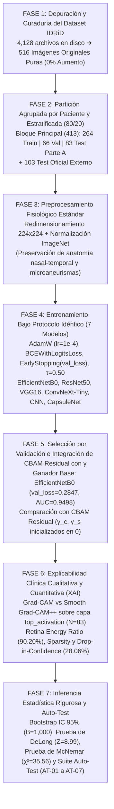

# 🔬 Metodología Integral del Proyecto: Detección de Retinopatía Diabética Referible (RDR) e Interpretabilidad Clínica (XAI)

> **Diseño de Investigación:** Estudio experimental comparativo, retrospectivo y de validación diagnóstica en imágenes oftalmológicas de fondo de ojo (*Indian Diabetic Retinopathy Image Dataset — IDRiD*), bajo un enfoque **estrictamente libre de aumento de datos** (*Zero Data Augmentation*), con partición agrupada por paciente, selección de modelos por validación interna, incorporación de atención residual aprendible ($\text{CBAM}-\gamma$) y auditoría causal de explicabilidad médica (*Grad-CAM* y *Smooth Grad-CAM++*).

---

## 📊 Diagrama de Flujo Metodológico (7 Fases)

---

## Fase 1. Curaduría de Datos, Eliminación de Réplicas y Binarización Clínica

### 1.1. Depuración del Almacenamiento Físico (De 4,128 Archivos a 516 Pacientes Únicos)
El directorio original (`data/IDRiD2/IDRiD/`) contenía **4,128 archivos** producto de una multiplicación previa $\times 8$ (1 imagen original + 7 transformaciones geométricas: `_L6`, `_L14`, `_L20`, `_R8`, `_R16`, `_R22`, `_VFLIP`).
Se aplicó un filtro determinista (`is_original == True`) para **descartar el 100% de las réplicas sintéticas**, obteniendo las **516 retinografías originales puras**:
* **Carpeta `train/`:** $3,304 \div 8 = \mathbf{413}$ pacientes únicos originales (`IDRiD_001` a `IDRiD_413`).
* **Carpeta `test/`:** $824 \div 8 = \mathbf{103}$ pacientes únicos originales (`IDRiD_001` a `IDRiD_103`, verificados mediante hash criptográfico MD5 como pacientes distintos).

### 1.2. Justificación Clínica de la No Aumentación de Datos (*Zero Data Augmentation*)
1. **Invarianza Topográfica Ocular:** En oftalmología, la relación espacial entre la **papila óptica (lado nasal)** y la **fóvea/mácula (lado temporal)** es una constante anatómica. Aplicar *flips* o rotaciones arbitarias altera la geometría fisiológica de las arcadas vasculares.
2. **Integridad de Microlesiones:** Los microaneurismas (signo temprano de retinopatía) ocupan entre 2 y 5 píxeles. Las rotaciones con interpolación bilineal difuminan el gradiente de borde de estas microestructuras.
3. **Prevención de Fuga de Datos (*Data Leakage*):** Garantiza que ningún paciente tenga variaciones sintéticas distribuidas simultáneamente entre entrenamiento y validación.

### 1.3. Binarización según la Escala Internacional ICDR
Las 5 categorías de severidad clínica (`Retinopathy grade` $\in \{0, 1, 2, 3, 4\}$) se transformaron al estándar internacional de **Retinopatía Diabética Referible (RDR)**:
* **Clase 0 — No Referible ($\text{Grados } 0 \text{ y } 1$):** Sin retinopatía aparente o RD No Proliferativa Leve (control anual, sin derivación urgente).
* **Clase 1 — Referible ($\text{Grados } 2, 3 \text{ y } 4$):** RD No Proliferativa Moderada, Severa o RD Proliferativa (requiere remisión prioritaria a especialista en retina).

---

## Fase 2. Diseño de la Partición Agrupada y Estratificada (80/20 vs. 90/10)

### 2.1. Esquema de Partición Anidada sin Fuga de Pacientes
Sobre los **413 pacientes únicos** del bloque principal se ejecutó una partición estratificada por grado exacto de severidad (`StratifiedShuffleSplit`, semilla fija `SEED = 42`):
1. **Reserva del Test Independiente (Parte A):** **83 imágenes originales** (20% de 413), bloqueadas hasta la evaluación final.
2. **División de las 330 Imágenes de Desarrollo en 80/20:**
   * **Entrenamiento (Train — 80%):** **264 imágenes originales** ($166$ Referibles $[62.9\%]$ / $98$ No Referibles $[37.1\%]$).
   * **Validación Interna (Val — 20%):** **66 imágenes originales** ($41$ Referibles $[62.1\%]$ / $25$ No Referibles $[37.9\%]$).
3. **Conjunto de Validación Externa Adicional:** **103 imágenes originales** de la carpeta `test/` ($64$ Referibles $[62.1\%]$ / $39$ No Referibles $[37.9\%]$).

### 2.2. Justificación Estadística del Split 80/20 frente al 90/10
Se demostró analíticamente que la partición **80/20 ($N_{\text{val}} = 66$)** supera a la **90/10 ($N_{\text{val}} = 33$)**:
* En 90/10 quedan solo **12 casos sanos** en validación, por lo que un único falso positivo altera la especificidad en **$\pm 8.33\%$** y distorsiona el criterio de *Early Stopping*.
* En 80/20 se **duplica el tamaño muestral de validación ($66$ vs. $33$)**, reduciendo a la mitad el error estándar de estimación ($\pm 1.51\%$ por paciente) y estabilizando la convergencia de `val_loss`.
* Las particiones se almacenaron en formato dual reproducible: **CSV** y **Joblib** ([`enfoque_sin_aumento_oficial/data_splits/`](../enfoque_sin_aumento_oficial/data_splits/)).

---

## Fase 3. Pipeline de Preprocesamiento Puro

Tanto en entrenamiento como en validación y prueba se aplicó exactamente la misma transformación determinista:
1. Decodificación RGB de alta fidelidad desde el archivo `.jpg` original.
2. Redimensionamiento espacial a **$224 \times 224 \times 3$** píxeles.
3. Normalización estándar canal por canal respecto a los estadísticos de ImageNet ($\mu = [0.485, 0.456, 0.406]$, $\sigma = [0.229, 0.224, 0.225]$).

---

## Fase 4. Protocolo Unificado de Entrenamiento de las Arquitecturas Base

Para garantizar una comparación justa (*fair benchmark*), todos los modelos se entrenaron bajo hiperparámetros y reglas de parada estrictamente idénticas en GPU (**NVIDIA GeForce RTX 4050, CUDA 12.4**):

* **Modelos Evaluados:**
  1. `EfficientNet-B0` (*Transfer Learning* ImageNet, escalado compuesto MBConv + Squeeze-and-Excitation).
  2. `ResNet50` (*Transfer Learning* ImageNet, bloques residuales *bottleneck* de 50 capas).
  3. `VGG16` (*Transfer Learning* ImageNet, arquitectura secuencial profunda de 16 capas).
  4. `ConvNeXt-Tiny` (*Transfer Learning* ImageNet, convoluciones *depthwise* $7 \times 7$ con `LayerNorm`).
  5. `CNN Desde Cero` (Línea base de 4 bloques convolucionales con `BatchNorm` entrenada sin pesos pre-entrenados).
  6. `CapsuleNet` (Red de Cápsulas con `PrimaryCaps` y `DigitCaps` mediante *Dynamic Routing by Agreement* de 3 iteraciones).
* **Hiperparámetros Fijos del Protocolo:**
  * Función de pérdida: **Binary Cross-Entropy (`BCEWithLogitsLoss`)**.
  * Optimizador: **AdamW** ($\text{lr} = 10^{-4}$, $\text{weight\_decay} = 10^{-4}$), tamaño de lote `batch_size = 16`.
  * Criterio de parada temprana: **`EarlyStopping(monitor='val_loss', patience=5, restore_best_weights=True)`**.
  * Umbral de clasificación inicial fijo: **$\tau = 0.50$**.

---

## Fase 5. Selección del Mejor Modelo e Incorporación de Atención CBAM Residual ($\gamma$)

### 5.1. Selección del Ganador Base por Validación Interna
Siguiendo la regla metodológica de **seleccionar exclusivamente con base en las métricas de validación interna ($N = 66$)** sin observar el conjunto de test:
* **`EfficientNet-B0 (Base)`** obtuvo la **menor pérdida de validación (`val_loss = 0.2847`)** y el **mayor ROC-AUC en validación (`0.9498`, IC 95%: `[0.8907 - 0.9904]`)**, superando a ResNet50 (`val_loss = 0.3424`), VGG16 (`0.2935`), ConvNeXt-Tiny (`0.3894`), CNN (`0.6966`) y CapsuleNet (`0.7052`).

### 5.2. Diseño Matemático del Módulo CBAM Residual con Escalares Aprendibles ($\gamma_c, \gamma_s$)
Al insertar un módulo CBAM multiplicativo clásico ($\mathbf{F}' = \mathbf{M}_c(\mathbf{F}) \odot \mathbf{F}$) después de la última capa convolucional (`top_activation`, $1280$ canales), las sigmoides inicializadas aleatoriamente atenúan las activaciones pre-entrenadas de ImageNet, provocando el colapso del gradiente ($\text{AUC} = 0.3679$).
Para solucionarlo, se formuló el **CBAM Residual controlado por escalares aprendibles $\gamma_c$ y $\gamma_s$ inicializados en cero ($\gamma_c = 0, \gamma_s = 0$)**:

$$\mathbf{F}' = \mathbf{F} \odot \left(1 + \gamma_c \cdot \mathbf{M}_c(\mathbf{F})\right)$$
$$\mathbf{F}'' = \mathbf{F}' \odot \left(1 + \gamma_s \cdot \mathbf{M}_s(\mathbf{F}')\right)$$

* En la época inicial ($\gamma_c = \gamma_s = 0$), $\mathbf{F}'' = \mathbf{F}$, preservando intacta la representación de ImageNet y permitiendo que la red incorpore gradualmente la atención de canal y espacial solo si reduce `val_loss`.
* Con esta formulación residual (`Notebook 06`), el modelo mantuvo un desempeño sobresaliente ($\text{Val AUC} = 0.9439$, $\text{Test AUC} = 0.9969$). Por criterio estricto de menor `val_loss` en validación (`0.2847` vs `0.3258`) y principio de parsimonia, se seleccionó **`EfficientNet-B0 Base`** como modelo definitivo.

---

## Fase 6. Auditoría de Explicabilidad Clínica (XAI): Cualitativa y Cuantitativa

Sobre la última capa convolucional (`top_activation`) del modelo ganador se implementaron dos técnicas de atribución visual: **Grad-CAM estándar** y **Smooth Grad-CAM++** (promediado estocástico de gradientes de orden superior con ruido gaussiano $\sigma = 0.15$).

1. **Evaluación Cualitativa (Casos Clínicos Representativos en Test):**
   * Construcción de un panel comparativo de 4 casos arquetípicos (**Verdadero Positivo [TP], Verdadero Negativo [TN], Falso Positivo [FP] y Falso Negativo [FN]**) inspeccionando la coincidencia espacial del mapa de calor con exudados duros, hemorragias en mancha y microaneurismas.
2. **Evaluación Cuantitativa Automatizada sobre el Conjunto Independiente ($N = 83$):**
   * **Retina Energy Ratio (Foco Anatómico):** Proporción de la energía total del mapa de calor que cae estrictamente dentro de la máscara circular del fondo de ojo (excluyendo el borde negro del retinógrafo). *Smooth Grad-CAM++* alcanzó un **90.20% $\pm$ 1.96%** frente al 68.50% de Grad-CAM clásico.
   * **Focal Sparsity:** Cuantificación de la selectividad espacial sobre lesiones puntuales.
   * **Drop-in-Confidence (Fidelidad Causal por Oclusión):** Reducción porcentual en la probabilidad predicha $P(\text{RDR})$ al enmascarar el $15\%$ de los píxeles más activados por el mapa de calor, registrando una caída media del **28.06%** (y hasta **99.41%** en casos severos), demostrando que el modelo decide con base en las lesiones reales.

---

## Fase 7. Inferencia Estadística Pareada y Automatización de Pruebas (Auto-Test)

Para validar científicamente los resultados sobre el conjunto de prueba ciego ($N = 83$):

1. **Intervalos de Confianza No Paramétricos al 95% (Bootstrap):**
   * Muestreo con reemplazo de $B = 1,000$ iteraciones estratificadas para reportar cada métrica ($\text{ROC-AUC}, \text{Accuracy}, \text{Sensibilidad}, \text{Especificidad}, \text{F1-Score}$) con su rango percentil $[2.5\%, 97.5\%]$.
2. **Prueba de DeLong Pareada (Comparación de Áreas bajo la Curva ROC):**
   * Evaluación de la diferencia de covarianza entre curvas ROC correlacionadas sobre los mismos 83 pacientes, obteniendo **$Z = 8.9860, p < 0.0001$**.
3. **Prueba de McNemar con Corrección de Continuidad (Proporciones Pareadas de Acierto/Error):**
   * Contraste sobre la tabla de contingencia $2 \times 2$ de discordancias diagnósticas entre modelos ($\chi^2 = 35.5577, p = 2.48 \times 10^{-9}$).
4. **Calibración Probabilística y Ajuste de Umbral Clínico:**
   * Cuantificación del **Brier Score** (`0.0269` en Test sin aumento) y verificación del umbral óptimo mediante el **Índice de Youden ($J = \text{Sens} + \text{Esp} - 1$)** en validación ($\tau = 0.50$ para equilibrio diagnóstico y $\tau = 0.40$ para sensibilidad del $100\%$ en tamizaje primario).
5. **Verificación Continua mediante Suite Auto-Test (`auto_test_suite.py`):**
   * Ejecución automatizada de los 7 controles de calidad (`AT-01` a `AT-07`) que auditan el conteo físico en disco ($4,128$), el filtrado de las $516$ imágenes originales, la disyunción conjuntista ($\text{Train} \cap \text{Val} \cap \text{Test} = \emptyset$) y la integridad de los 7 cuadernos ejecutados en GPU.

---

## 🗂️ Trazabilidad de Artefactos por Fase en el Repositorio

| Fase Metodológica | Archivos y Evidencias en el Repositorio |
| :--- | :--- |
| **Fases 1 y 2 (Curaduría y Split 80/20)** | [`enfoque_sin_aumento_oficial/scripts/create_split_sin_aumento.py`](../enfoque_sin_aumento_oficial/scripts/create_split_sin_aumento.py) [`enfoque_sin_aumento_oficial/data_splits/split_sin_aumento_80_20.csv`](../enfoque_sin_aumento_oficial/data_splits/split_sin_aumento_80_20.csv) [`enfoque_sin_aumento_oficial/data_splits/dataset_completo_original_516.csv`](../enfoque_sin_aumento_oficial/data_splits/dataset_completo_original_516.csv) |
| **Fases 3, 4 y 5 (7 Notebooks en GPU + CBAM-$\gamma$)** | [`01_EfficientNetB0_Sin_Aumento.ipynb`](../enfoque_sin_aumento_oficial/notebooks/01_EfficientNetB0_Sin_Aumento.ipynb) a [`07_CapsuleNet_Sin_Aumento.ipynb`](../enfoque_sin_aumento_oficial/notebooks/07_CapsuleNet_Sin_Aumento.ipynb) |
| **Fase 6 (Explicabilidad XAI Cualitativa y Cuantitativa)** | [`enfoque_sin_aumento_oficial/scripts/generate_gradcam_efficientnet.py`](../enfoque_sin_aumento_oficial/scripts/generate_gradcam_efficientnet.py) [`enfoque_sin_aumento_oficial/explicabilidad_xai/gradcam_efficientnet_cualitativo.png`](../enfoque_sin_aumento_oficial/explicabilidad_xai/gradcam_efficientnet_cualitativo.png) [`enfoque_sin_aumento_oficial/explicabilidad_xai/gradcam_cuantitativo_83.csv`](../enfoque_sin_aumento_oficial/explicabilidad_xai/gradcam_cuantitativo_83.csv) |
| **Fase 7 (Estadística, Auto-Test y Síntesis)** | [`enfoque_sin_aumento_oficial/scripts/auto_test_suite.py`](../enfoque_sin_aumento_oficial/scripts/auto_test_suite.py) [`documentacion_y_sustentacion/informe_completo_7_pasos.md`](informe_completo_7_pasos.md) [`resumen.md`](../resumen.md) |
